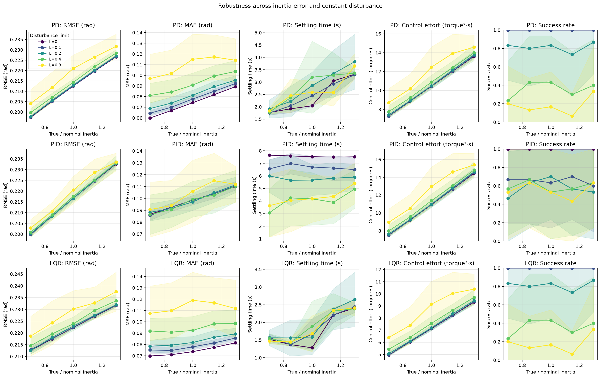
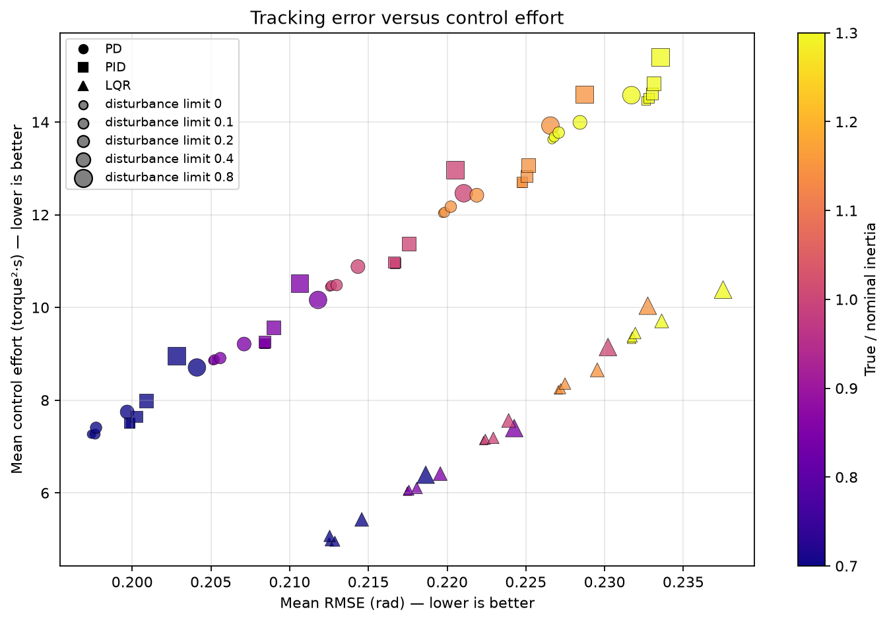

# ロバスト性実験：結果と考察

## 実験の概要

1自由度の回転系で、PD・PID・LQRを慣性誤差と一定外乱トルクのもとで比較した。目標角度は1 rad、初期角度・初期角速度は0、シミュレーション時間は8 s、刻み幅は0.01 s、成功判定の許容誤差は0.02 radである。

真の慣性は「名目慣性 × 慣性比」で設定した。慣性比は0.7、0.85、1.0、1.15、1.3、外乱上限は0、0.1、0.2、0.4、0.8 N·mとし、各組合せを30回反復した。上限を `L` とすると、各反復の外乱トルクは `τ_d ∼ Uniform(-L, L)` から抽選し、その反復では全制御器に同じ一定外乱を加えた。乱数seedは20261012である。

PDとPIDの比例・微分ゲインは `Kp=8`、`Kd=3` とし、積分ゲインはそれぞれ `Ki=0`、`Ki=1` とした。LQRは名目モデルで `Q=diag(64, 4)`、`R=1` を用いた。すべての制御器のトルク指令上限は±20 N·mである。

## 生成物

- [全試行のデータ](../results/robustness_trials.csv)：制御器、条件、各反復の指標と抽選された外乱
- [条件別の統計](../results/robustness_summary.csv)：平均、標本標準偏差、整定時間の有効試行数
- [条件に対する性能曲線](../results/robustness_curves.png)：平均と±1標準偏差
- [誤差と制御努力のトレードオフ](../results/robustness_tradeoff.png)





## 数値結果

名目慣性（慣性比1.0）での結果を、外乱なしと外乱上限0.8 N·mで比較する。誤差・制御努力・整定時間は30反復の平均である。外乱ありのRMSE欄は平均±標準偏差を示す。

| 制御器 | 外乱上限 (N·m) | RMSE (rad) | 整定時間の平均 (s) | 整定時間の有効数 | 制御努力 (N²·m²·s) | 最終時点の成功率 |
|---|---:|---:|---:|---:|---:|---:|
| PD | 0.0 | 0.2125 | 2.04 | 30/30 | 10.44 | 100% |
| PID | 0.0 | 0.2167 | 7.53 | 30/30 | 10.94 | 100% |
| LQR | 0.0 | 0.2223 | 1.28 | 30/30 | 7.13 | 100% |
| PD | 0.8 | 0.2211 ± 0.0065 | 2.59 | 5/30 | 12.46 | 16.7% |
| PID | 0.8 | 0.2205 ± 0.0064 | 4.19 | 16/30 | 12.96 | 53.3% |
| LQR | 0.8 | 0.2302 ± 0.0077 | 1.68 | 5/30 | 9.15 | 16.7% |

外乱なしの行は、同じ条件を30回繰り返しているため標準偏差が0になる。これは試行ごとの初期状態やモデルに乱数を加えておらず、同じ決定論的計算を反復しているためである。

## 考察

### 誤差と入力のトレードオフ

名目条件・外乱なしでは、PDのRMSEが最小（0.2125 rad）だった。一方、LQRはRMSEが0.2223 radと少し大きいものの、制御努力は7.13で、PDの10.44より小さい。LQRはこの重み設定で入力を節約する傾向を示した。したがって、単一の指標だけで制御器の優劣は決められず、誤差と入力の両方を評価する必要がある。

### 積分項と一定外乱

外乱上限0.8 N·mでは、PIDの最終時点成功率は53.3%で、PDとLQRの16.7%を上回った。積分項が一定外乱による定常誤差を補償した結果と整合する。ただし、PIDの制御努力は12.96で3方式中最も大きく、外乱なしの名目条件では平均整定時間も7.53 sと長かった。今回の `Ki=1` では外乱補償と整定速度にトレードオフが見られる。

### 慣性誤差

外乱なしでは、慣性比が0.7から1.3へ大きくなるにつれて、3方式とも概ねRMSEと制御努力が増加した。たとえばPDのRMSEは0.1974 radから0.2267 radへ、制御努力は7.27から13.62へ増えた。名目モデルより慣性が大きい回転系では、今回の固定ゲインが同じ応答を保てず、性能が変化したことを示している。

### ばらつきと成功率の読み方

図の帯は平均±1標準偏差であり、信頼区間ではない。外乱なしでは全反復が同一条件なのでばらつきが出ない。外乱上限が大きいほど、抽選された外乱の符号・大きさによって指標に差が出る。整定時間は、許容範囲に入った後ずっと範囲内に留まる場合だけ計算し、整定しなかった反復は平均から除外している。そのため、整定時間の平均だけでなく、有効数と成功率も併せて見る必要がある。

## 結果の適用範囲と限界

この結果は、今回選んだゲイン・LQR重み・トルク上限でのシミュレーション比較であり、PD・PID・LQRという方式一般の優劣を示すものではない。ゲインと重みを各条件に合わせて最適調整していないため、次の比較では調整手順も公平に定義する必要がある。

モデルは1自由度の剛体回転、一定慣性、一定粘性減衰であり、慣性のみを変えて減衰は名目値のままにした。角度・角速度は完全に観測できると仮定し、センサー雑音、遅延、クーロン摩擦、バックラッシュ、柔軟性、アクチュエーター動特性は含めていない。外乱は時間変動する風や振動ではなく、各試行中ずっと一定のトルクである。状態の時間更新には前進オイラー法を使う。したがって、この結論を実機性能へそのまま一般化することはできない。

## 再現方法

リポジトリのルートで、依存関係をインストールしたPython環境から次を実行する。

```powershell
python scripts/run_robustness.py
```

条件・制御器設定・seedは [`experiments/robustness.yaml`](../experiments/robustness.yaml) にある。
